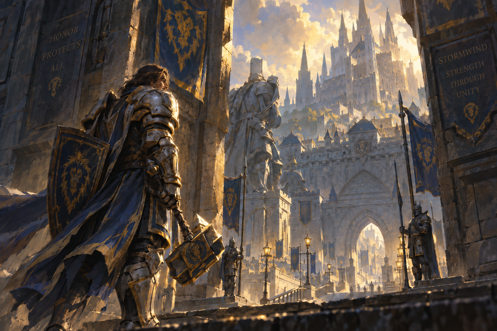

<p align="center">
  
</p>

# Omarchy Human Paladin Theme

An Omarchy theme for Stormwind in full sun. Alliance blue and antique gold sit on pale stone and warm parchment.

This is a light theme (`mode = "light"`).

## Install

```sh
omarchy-theme-install https://github.com/csfh/omarchy-human-paladin-theme
```

You can also install it from the Omarchy menu with `Super + Alt + Space`, then `Install > Style > Theme`, using this repository URL:

```text
https://github.com/csfh/omarchy-human-paladin-theme
```

## Palette

| Role | Hex |
| --- | --- |
| Background | `#f4f0e6` |
| Foreground | `#1c1b24` |
| Accent | `#a67c00` |
| Red | `#a83a2c` |
| Green | `#4a7040` |
| Yellow | `#89690e` |
| Blue | `#26499a` |
| Magenta | `#70487e` |
| Cyan | `#2f7385` |

## Included

A `colors.toml` palette, an icon theme (`Yaru-yellow`) and a wallpaper. Omarchy builds the terminal, editor, launcher, notification, bar, lock screen, browser and TUI themes from this palette, so `colors.toml` is the single source of truth.

## Backgrounds

The wallpaper:

- [`human-paladin`](backgrounds/human-paladin.png)

## License

MIT. See [LICENSE](LICENSE). Copyright (c) 2026 Christoffer Hallas.

If you send a pull request or other contribution, you agree to the [CLA](CLA.md).
